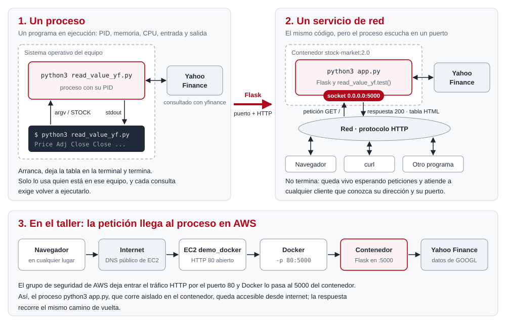

# Stock Market como servicio web

Taller 1 «Despliegue de servicios de red» de Computación Distribuida y Frameworks para Desarrollo de Aplicaciones Inteligentes (Univalle).

Sigue la guía del taller paso a paso:

1. el script que consulta Yahoo Finance;
2. su imagen de Docker;
3. el servicio web con Flask;
4. la publicación de la imagen en Docker Hub;
5. su ejecución en una máquina virtual EC2 de AWS.

## Archivos

| Archivo | Qué es |
|---|---|
| `read_value_yf.py` | El script de la guía: `get_stock_data` trae los precios de un stock entre dos fechas y `test` prueba con GOOGL desde 2020. Agrega `promedio_cierre`, el segundo paso del algoritmo del escenario |
| `Dockerfile.cli` | El primer Dockerfile de la guía (imagen `stock-market:1.0`): el script como comando, con el stock en la variable `STOCK` |
| `app.py` | El servicio web de la guía: Flask expone `test()` en `/` como una tabla HTML. Agrega `/stock/<ticker>` y `/health` |
| `Dockerfile` | El segundo Dockerfile de la guía (imagen `stock-market:2.0`): el servicio en el puerto 5000 |
| `docs/proceso_a_servicio.svg` | La gráfica que pide la guía: qué es un proceso y cómo se convierte en un servicio de red |

## 1. El script en un contenedor: `stock-market:1.0`

```bash
docker image build -t stock-market:1.0 -f Dockerfile.cli .
docker container run --rm stock-market:1.0                 # GOOGL
docker container run --rm -e STOCK=AMZN stock-market:1.0   # otro stock
```

La guía usa un solo `Dockerfile` y lo reescribe para la versión 2.0. Aquí quedan los dos, y por eso la 1.0 se construye con `-f Dockerfile.cli`.

## 2. De proceso a servicio de red

Un **proceso** es un programa en ejecución. El sistema operativo le asigna un identificador (PID), memoria, tiempo de CPU y una entrada y una salida estándar.

`python3 read_value_yf.py AMZN` es un proceso:

- recibe el stock como argumento;
- consulta Yahoo Finance;
- escribe la tabla en la terminal y termina.

Solo lo puede usar quien está en ese equipo, y cada consulta exige ejecutarlo de nuevo.

Un proceso se convierte en un **servicio de red** cuando, en vez de terminar, abre un *socket* y lo asocia a una dirección y un puerto. Desde ahí queda escuchando las peticiones que llegan por la red en un protocolo acordado.

Eso hace Flask en `app.py`:

- `app.run(host="0.0.0.0")` deja el proceso escuchando en el puerto 5000 de todas las interfaces.
- Cada petición HTTP `GET /` llega a `hello_world()`, que llama a `read_value_yf.test()`.
- La respuesta, la tabla en HTML, vuelve al cliente, y el proceso sigue vivo esperando la siguiente.

Ya no importa dónde esté el cliente: le basta conocer la dirección y el puerto, y hablar HTTP.



## 3. El servicio web: `stock-market:2.0`

```bash
docker image build -t stock-market:2.0 .
docker container run --rm --name stock-market -p 5000:5000 stock-market:2.0
# http://localhost:5000
```

| Ruta | Qué devuelve |
|---|---|
| `/` | La tabla HTML de la guía: precios de GOOGL desde 2020 |
| `/stock/<ticker>?inicio=YYYY-MM-DD&fin=YYYY-MM-DD` | JSON con los días de mercado y el promedio de cierre del periodo |
| `/health` | Estado del servicio |

## 4. Publicación en Docker Hub

```bash
docker image tag stock-market:2.0 andresdfx/stock-market:2.0
docker login
docker image push andresdfx/stock-market:2.0
```

## 5. Despliegue en AWS EC2

1. En la consola de AWS, ir a EC2 y dar *Launch instance* con:
   - nombre `demo_docker`;
   - imagen Ubuntu, apta para la capa gratuita;
   - un par de llaves nuevo `demo_docker`, que descarga `demo_docker.pem`;
   - la opción *Allow HTTP traffic from the internet*.
2. Conectarse por SSH con la cadena que muestra *Connect*:
   ```bash
   chmod 400 demo_docker.pem
   ssh -i "demo_docker.pem" ubuntu@<DNS público de la instancia>
   ```
3. Acondicionar la máquina:
   - instalar Docker según https://docs.docker.com/engine/install/ubuntu/;
   - habilitar al usuario `ubuntu` para ejecutar contenedores;
   - descargar la imagen publicada y ejecutarla.
   ```bash
   sudo usermod -aG docker ubuntu        # y volver a entrar
   docker image pull andresdfx/stock-market:2.0
   docker container run -d --name stock-market -p 80:5000 andresdfx/stock-market:2.0
   ```
4. Abrir `http://<DNS público de la instancia>` en el navegador: aparece la tabla.
5. **Terminar la instancia** (*Instance state → Terminate instance*) para no generar cobros.

## Diferencias con la guía

Los dos Dockerfiles son los de la guía, al pie de la letra. Docker avisa por `WORKDIR work` (ruta relativa) y por el formato antiguo `ENV STOCK 'GOOGL'`. Son avisos de estilo y no cambian el resultado.

Lo demás cambia poco, y por estas razones:

- **`requirements.txt`.**
  - `yfinance` 0.2.58 o posterior, con `curl_cffi`. Yahoo bloquea las peticiones simples que salen de las IP de los proveedores de nube; con estas versiones, las peticiones se presentan como las de un navegador.
  - `pandas<3`. `yfinance` todavía usa funciones que pandas 3 marca como obsoletas, y la salida se llena de advertencias.
- **`read_value_yf.py`.**
  - La fecha final por defecto se calcula en cada llamada. En la guía, `ed = date.today()` se evalúa una sola vez, al importar el módulo, así que un servicio que lleva días corriendo dejaría de ver los datos nuevos.
  - `auto_adjust=False` conserva la columna *Adj Close* que muestra la salida de la guía.
- **`app.py`.** Además de `/`, tiene `/stock/<ticker>` y `/health`. Escucha en el puerto de la variable `PORT` si existe; si no, en el 5000, como en la guía.

## Otro despliegue

El mismo repositorio está desplegado en Render, que no hace parte de la guía: https://stock-market-flask.onrender.com.

Render construye la imagen con el `Dockerfile` en cada push a `main`. En el plan gratuito, la primera petición tras un rato de inactividad tarda unos segundos.
